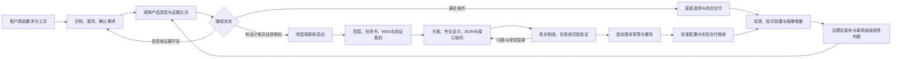

# 连接器研发全局：内部方案证据、平台定位与待定事项

研究日期：2026-10-28。范围：内部方案与现有原型/代码说明的只读取证。本笔记记录补充方案形成前的原文状态；随后总稿对整体方案入口、知识治理时机、实例服务及知识文件边界作了一致性修订。涉及这些修改的原文引用指向修改前备份，其他引用保留原文件。没有修改应用代码、业务数据或提交 Git。

本文将资料中的业务要求作为研究对象，不将其视为要求本轮执行的指令。**“方案已明确”是目标要求；“代码可确认”是当前实现证据；“研究建议”不是已获业务批准的制度；“待定”需要明确责任人和可核验的决定。** 文中的平台 Owner 指事实维护、合法状态变更和最终回执的责任域，不等同服务器、数据库品牌或页面所在位置。

阅读范围包括《整体方案》、六个主题方案的完整目录，以及其中全局职责、工程对象、角色、跨平台交接、生命周期、集成和验收的相关正文；全文阅读《研发管理平台使用说明.html》，并对照当前 AiNative 交接说明和生成入口。没有据此声称已核验厂商真实产品能力、现场组织制度、生产接口或工程效果。

## 1. 全局首先是什么

**方案已明确：这是围绕连接器产品工程活动形成的协同体系，主线是需求 → 选型 → 直接选用或改型/新研 → 设计与验证 → 审签与实际交付 → 知识复用。研发管理平台是其中工程业务办理和协同的责任域，研制任务书是改型/新研启动后的一个受控工作包。** 不是所有需求都必须新建研发项目，也不是生成了任务书就完成了研发管理。[整体方案:5][G5]、[整体方案:19][G19]、[主题一:2337][B2337]、[主题一:3933][B3933]

上图是研究归纳，不新增关口。仿真、试验和治理可发生在适用节点，不必全部排在设计之后；选型证据不足可安排获授权的补证工作，不自动升级成完整研发项目；缺库存首先是供应问题。任务数完成、工具运行成功、仿真结果有效、产品满足要求是不同事实。[主题一:3924][B3924]、[主题一:3941][B3941]、[主题一:6073][B6073]

**全局应同时管理三种连接：** 需求与产品配置的技术关联、人员与任务的责任交接、知识/规则/能力在不同版本下的采用关系。方案要求工作包明确目标、配置、需求引用、固定输入、动作、交付物、接受标准、责任角色、依赖、计划、风险和关闭证据；这比增加几个“需求/任务/成果”列表更接近其业务定位。[主题一:46][B46]、[主题四:4051][T4051]

## 2. 四个平台分别对什么负责

| 平台/责任域 | 自己维护的权威对象 | 向其他域提供什么 | 不应代替什么 |
| --- | --- | --- | --- |
| **研发管理/研发协同** | 选型与研发业务事项、项目、需求和配置采用、流程实例、任务、项目资料、成果、问题、变更、人审决定、交接及实际业务回执 | 固定输入、任务上下文、工程候选与人工决定、治理申请、知识/画像增量、采用和效果反馈 | 不代替 Workspace 维护通用能力；不让运行成功代替工程接受或批准 |
| **K-box 知识平台** | 受控知识内容和准入记录、治理作业、知识版本、客户/产品画像主档、发布与撤回记录 | 有来源、权限、适用范围和状态的知识/画像；治理和发布回执 | 不吞并全部项目过程库；不成为 ERP 库存、PDM 已发布文件、试验原始结果的另一个主系统 |
| **本体管理平台** | 工程概念、对象/关系/属性定义、规则、标准效力、流程与动作语义、函数/工具契约、来源到目标结构的映射及批准版本 | 统一语义、适用规则、结构约束、映射、影响关系和可执行动作定义 | 不代替工程审批；关系投影不变成业务事实；不能仅作为任务书空格字典 |
| **Workspace** | 专家/Agent、Skill、专家团队/动作模板的源码、配置、依赖、评测、固定制品、发布和应用授权 | 可验证的能力固定版本、可用目录、授权与兼容信息、来源域治理任务所需的执行能力 | 不维护第二套研发项目事实；发布不自动授权，授权不自动被项目采用 |
| Runtime / C03 等配套执行服务 | Run、StepRun、检查点、技术等待、运行证据和用量；C03 负责适配 | 候选结果、实际输入/制品版本、工具回执、失败和未覆盖项 | **不是第五个平台**；不拥有工程批准，也不另建项目业务编排真值 |
| PDM / ERP / MES / LIMS / CAE 等源系统 | 各自已发布设计、物料/库存、制造实绩、原始试验或专业执行事实 | 带身份、版本、工况、时间和真实接收结果的输入/回执 | 被读取、导入、检索或缓存不代表源系统权威转移 |

以上责任划分来自方案，而非本研究重新设计：[整体方案:33][G33]、[主题一:3978][B3978]、[主题三:916][W916]、[主题四:3529][T3529]。本体定义、K-box 内容、Workspace 实现和研发采用各有生命周期；同一个页面可以呈现它们，但写入仍回到相应责任域。[主题二:1135][O1135]、[主题三:945][W945]

**研发平台的准确定位：让正确的人基于明确版本和足够证据完成工程决定，把工作可靠交给下一责任人，并保留后来能追查的全过程。** 它可以提供知识查询、画像维护和治理申请的统一入口，但入口统一不等于事实归属统一。[主题一:3990][B3990]、[主题一:4316][B4316]、[主题二:1135][O1135]

## 3. 全局必须识别的对象和状态

| 对象族 | 责任域与关键关系 | 不能合并掉的区别 |
| --- | --- | --- |
| 客户输入、澄清、需求修订 | 原始资料留来源/研发过程库；研发形成确认需求及采用关系，保留原文定位和工况 | 客户原始陈述、AI 提取、人员采纳、客户确认；未知不能自动成为确认事实 |
| 选型事项、路线决定、研发项目 | 研发域；选型对象关联候选产品/证据/差异，获改型或新研授权后进入相应项目工作 | 业务承接或选型空间不等于已获授权的研发项目；直接选用不应制造研发 WBS |
| 产品、母型、零件、BOM、接口、配置 | 研发管理本次设计和采用实例；外部已发布设计保留 PDM 等源权威 | 声明性能、经验证性能、批准配置、实际制造配置、实际受试配置不能混成一个“当前产品” |
| 工作包、任务、交接 | 研发域；绑定固定输入、方法、成果、责任和接受条件 | 分派、承诺接单、输入就绪、开工、提交、接受分别发生；任务修订不等于成果版本 |
| 成果和证据 | 项目实际内容/版本由研发保存；专业来源保留来源责任，运行产物被接受后可靠留存 | 文件存在、证据有效、满足要求、可用于当前用途分别判断 |
| 审签轮次、整改意见、采用基线 | 研发域；审签固定内容与版本，意见、整改证据、复审和采用相连 | 批准、整改完成、配置实施、复验、下游采用、实际接收不等价；历史不能被新版静默覆盖 |
| 问题、变更、措施及影响处置 | 研发维护业务事实；定义/知识/能力问题返回其原责任域治理 | 变更获批不等于已实施；措施执行不等于有效；治理结束不等于原工程问题关闭 |
| 知识单元、客户/产品画像 | K-box 维护发布主档；项目保留自己采用的版本和适用性判断 | 项目条件不自动成为客户通性；推断不等于实测；发布、被采用和改善效果独立 |
| 本体/规则/映射修订 | 本体域批准固定版本；表达字段、语义、单位、约束、适用范围和来源映射 | 规则要求必须填写不等于已获得正确值；定义获批不等于能力已上线 |
| 能力制品、应用授权、执行与回执 | Workspace 管制品及应用授权，Runtime 管技术执行，原业务服务确认业务写入 | 发布、授权、环境就绪、流程可用、项目采用、运行成功、业务生效分别记录 |

依据：[主题一:2059][B2059]、[主题二:194][O194]、[主题二:200][O200]、[主题二:204][O204]、[主题三:1034][W1034]、[主题四:4083][T4083]。主题四给出的工程关联主线是“需求修订 → 任务书条目 → 候选方案版 → BOM/功能/接口 → 零件与专业任务 → 成果证据 → 固定评审包/决定 → 批准配置 → 实际样件/交付接收”。这应成为检查页面和数据是否断链的依据。[主题四:4053][T4053]

**研究建议：** 先画对象与状态图，再设计导航；每个对象至少说明稳定身份、独立修订、Owner、当前状态、采用用途、相关来源和权限范围。不要求把所有关系放入一个大图数据库，方案允许先用结构化字段/关系表，再做图查询投影。状态变更依然由所属业务服务负责。[主题二:428][O428]

## 4. 端到端到底交接什么

方案已有八类工程信息包：需求输入、设计工作包、选型复用、专业接口、仿真委托、验证回传、评审整改、设计交付。它们是跨角色必须传清的信息，不是强制新增八份报告或八道审批。[主题一:60][B60]

| 业务段 | 提供方 → 接收方 | 交接对象与继续条件 | 阻断/退回由谁处理 |
| --- | --- | --- | --- |
| 1. 需求承接与确认 | 客户接口/需求人员 → 选型及技术人员 | 原件、工况、需求修订、验收依据、澄清结果和未确定项；确认后进入选型，关键未知不得被假填 | 客户接口澄清来源；技术负责人处理规则/范围争议；独立可做部分可以继续 |
| 2. 选型及路线决定 | 选型人员 → 供应责任人，或获授权的研发负责人 | 固定需求、候选配置、适用证据、逐项差异、成本库存条件、路线及理由 | 缺库存交供应；缺报告补证；缺设计能力/证据不能只按相似率决定改型或新研 |
| 3. 改型/新研启动与策划 | 授权决策者/项目技术负责人 → 项目和专业团队 | 路线授权、范围、采用流程版、任务书、WBS、风险和验证策划；按实际制度批准范围并派发就绪任务 | 项目负责人处理资源承诺；技术负责人处理范围/技术基线；任务书本身不能替代启动授权 |
| 4. 方案与专业设计 | 系统技术负责人、设计专业 ↔ 其他专业及零件负责人 | 方案差异、BOM、分配要求、接口、固定输入、成本口径、交付物和接受标准 | 接口冲突由明确技术归口协调；专业任务完成后仍需整体装配、性能、工艺和风险收敛 |
| 5. 验证委托及回传 | 设计/分析委托人 → 仿真、试验、制造人员 → 接受人 | 实际配置、模型/样件、材料、载荷/边界、方法、判据；回传实际数据、可信度、覆盖和限制 | 专业人员判断有效性；技术负责人判断符合性；失败触发问题/变更和复验，不改写失败记录 |
| 6. 固定版本审签与整改 | 成果提供人 → 具资格的核验/审批人员 → 整改责任人 | 固定包、需求覆盖、差异、问题、证据、审签目的；意见逐项处置并按制度复审 | 审签人对决定负责；整改人对实际措施负责；不能以关闭弹窗或任务进度代替决定 |
| 7. 发布、交付及接收 | 项目/配置责任人 → PDM、制造、客户或其他实际接收者 | 批准配置、文件/BOM/验证证据、用途/限制、交付清单；记录真实发布和接收回执 | 未接收、版本冲突和失败回执回到原交接事项；发送成功不等于交付完成 |
| 8. 沉淀、画像与再采用 | 工程责任人 → K-box/本体/Workspace 各归口 → 后续项目 | 已接受成果或失败经验、来源、适用边界、治理申请；分别发布知识/规则/能力，再按新用途采用 | 各治理 Owner 返回原事项；研发核验影响并重测/采用；普通经验异步整理，关键风险仅阻断对应关口 |

主依据：[主题一:3924][B3924]、[主题一:4316][B4316]、[主题六:651][C651]、[主题六:677][C677]、[主题六:695][C695]、[主题二:1456][O1456]。表中归纳的角色名称必须映射现场岗位，不能据此虚构实际组织或审批权限。

### 三条跨平台协作链

1. **能力建设链：** 业务提出输入/输出及样本 → Workspace 构建和评测 → 涉及语义变化时本体批准定义 → 固定制品发布 → 应用授权 → 环境核验 → 研发流程和项目采用。发布、授权和采用之间不能自动跨越。[主题三:1027][W1027]、[主题四:3608][T3608]
2. **工程执行链：** 研发检查当前业务条件并固定上下文 → C03 请求 Runtime 执行指定能力 → 按需读取本体/K-box/专业工具 → 返回候选、证据和回执 → 研发可靠保存 → 人员依法规程核验和采用 → 研发流程依据实际事件前进。并非每次调用都要顺序经过四个平台。[主题三:1042][W1042]、[主题四:3614][T3614]
3. **治理反馈链：** 原任务发现数据、知识、规则或能力问题 → 原 Owner 的治理事项 → 固定样本复测和批准发布 → 回到原任务核验影响、采用或复测。不要为平台之间每次交接创建一个新的研发项目；技术治理与工程业务各有编排责任。[主题二:1452][O1452]、[主题三:1054][W1054]、[主题四:3558][T3558]

## 5. 不同角色应该看到不同工作，而非只换按钮

| 业务角色 | 默认需要看见 | 实际承担的决定 |
| --- | --- | --- |
| 客户接口/需求人员 | 原始要求、澄清、待确认项、客户条件与变化 | 确认来源和沟通结果；不能把模型推断标成客户确认 |
| 项目/资源负责人 | 范围、承诺、WBS、依赖、容量、计划/预测/实际、交付风险 | 分派、协调、资源承诺及计划办理；岗位身份不自然取得技术批准资格 |
| 系统/产品技术负责人 | 要求分配、功能与接口、整体匹配、证据覆盖、风险与配置差异 | 全局技术取舍、接口协调、适用范围和符合性判断 |
| 专业工程师 | 本人任务、固定输入、方法、候选/草稿、差异、交付标准和下一步 | 实际设计或分析、核验、提交与专业交接 |
| 核验/审签人员 | 固定送审包、前后差异、覆盖、整改意见及证据 | 按资格和制度作出对应目的的决定；技术运行结果不能替其签署 |
| 本体/知识/能力归口人员 | 来源、定义/映射、候选、评测、影响范围、发布及采用反馈 | 各自在所属平台办理定义、准入或能力发布，不互相越权 |
| 管理者/运营人员 | 项目组合、关键风险、待协调责任、交付与质量趋势 | 督办与协调；督办办结不等于原工程问题已经解决 |
| IT/平台运维 | 运行健康、等待、失败回执、积压、版本/权限和恢复情况 | 恢复技术服务、定位故障；不能通过运维操作批准工程结果 |

依据：[主题一:50][B50]、[主题一:4316][B4316]、[主题五:964][I964]、[主题五:982][I982]、[主题六:727][C727]。允许一人兼岗，但兼岗不取消资格、职责及必要的分离约束。[主题一:58][B58]

**方案中的页面组织也有层级：** 一级包含“我的工作、项目空间、研发管理、流程管理、知识管理、运营管理、系统管理”；项目内围绕“当前成果、项目流程、资料与画像”；研发管理负责客户画像、产品画像、项目与任务的关系。项目流程图与甘特读同一份计划，实际日期来自实际办理。管理模块助手负责查询定位，业务修改和审批仍在原工作面及原权限下执行。[主题一:3391][B3391]、[主题一:3396][B3396]、[主题一:3509][B3509]、[主题一:3667][B3667]、[使用说明:75][U75]、[使用说明:81][U81]

**研究判断：** 当前把项目、需求、任务、成果、审签并列成六个全局入口，便于演示对象 CRUD，却不能直接表达不同人员“我负责什么、基于什么继续、交给谁”。后续重整应从上述角色及交接出发，同时保留跨项目检索能力。此判断不意味着本轮立即实现方案全部菜单或节点。[当前交接说明:22][A22]、[当前交接说明:35][A35]

## 6. 本体、知识和任务书的关系

本体的全局作用包括定义工程对象及关系、规则和适用性、标准效力、动作及函数契约、数据结构和映射，以及受影响对象查询；最终应帮助回答“下一步做什么、依据什么、什么可采用、谁受影响、何时能释放”。因此，补齐任务书的“人工填写”只是其下游用途之一。[主题二:27][O27]、[主题二:706][O706]

方案区分 A 原始来源、B 本体批准结构/映射、C 受治理输出。B 规定需要什么字段、如何识别/转换/关联及核验；C 只有在来源、方法、身份、配置、工况、时点和权限成立时才能形成有依据的值。映射获批不等于治理作业已经执行；字段必填不等于能推断出值。[整体方案:62][G62]、[主题二:706][O706]、[主题二:714][O714]、[主题二:722][O722]

**研究建议：** 对任务书人工项先分成“已有权威事实可映射”“可用批准方法计算/转换”“工程人员必须决定”“资料不足尚不可确定”四类，再决定给生成器什么输入。这是一种分析方法，并非方案已定义的四类枚举。不能为减少人工项而把计划承诺、批准意见、缺失试验值或推断的产品能力自动补成事实。

知识治理也不是结项归档按钮。任务接受时按策略产生处置，可发布、关联已有知识、无需新增、驳回或延期；普通经验可异步，不阻止工程任务完成；涉及当前必需规范、关键风险或证据可用性的治理，只阻断明确关口。结项最终包、知识发布、画像更新和未来项目采用是另外几次有独立证据的完成。[主题二:1159][O1159]、[主题二:1456][O1456]、[主题二:1466][O1466]、[主题二:1468][O1468]

## 7. 当前 AiNative 处于全局的哪个位置

- **代码可确认：原生成入口仍是“LLM 多节点语义分类与规划 → 原文精确复制 → 图片注入 → 后处理 → QA → 报告”。其明确约束为 LLM 只输出 source_id 路由，不生成或改写正式正文。** 此边界应保留；全局建模不构成改写生成算法的理由。[pipeline_cli.py:291][P291]
- **交接说明所述已实现范围：** 研发项目、成员/职责、需求版本与基线、任务、成果、审签、持久化，以及项目任务内的 BP05 任务书编制、核验、WBS、审签、发布和交接。技术成功、自动检查、人工批准、计划发布、交接接受已经分开处理；这是可以保留的一条局部业务链。[当前交接说明:3][A3]、[当前交接说明:35][A35]、[当前交接说明:44][A44]、[当前交接说明:52][A52]
- **当前边界也已写明：** 改型/新研批准材料目前手工登记；不代办外部选型审批；没有通用流程引擎、多人会签、BOM/CAD/CAE/LIMS/ERP 集成或正式容量验收；单实例 SQLite、进程内生成队列；当前没有任意历史规则版本回放能力。[当前交接说明:44][A44]、[当前交接说明:64][A64]、[当前交接说明:123][A123]、[当前交接说明:154][A154]
- **验证证据的限度：** 说明记录了 206 项后端、26 项前端及浏览器样例验证，也明确演示数据和预置文档不是实际模型或工程验证结果。本次研究没有重新执行这些测试，更没有据此认定四平台集成或真实工程验收已完成。[当前交接说明:18][A18]、[当前交接说明:56][A56]、[当前交接说明:136][A136]、[当前交接说明:164][A164]

**研究判断：** 当前系统是以任务书为成熟核心的研发协同纵向样例。当前缺口应描述为“哪些全局对象、责任和交接还未实现/接通”，不能简化为“再加本体管理菜单”或“再补几个人工字段”。下一阶段可复用现有稳定版本、输入包、审签和交接机制，但需先把它们放回完整工程对象链。

原离线演示同样不能作为生产完成证明：说明明确预设对话、模板发布、节点审签是本地交互，尚未接真实模型、组织审签及库存价格系统，图纸与实验/仿真资料不替代正式签发和实测。[使用说明:83][U83]

## 8. 原资料具体不一致与缺口

以下不是“方案完全没有设计”，而是会影响下一步实现的矛盾、残留表述或尚未绑定的现实条件。

| 问题 | 原文证据 | 研究建议或待定点 |
| --- | --- | --- |
| 旧演示要求需求独立审签，最新整体方案取消独立关口 | 10 月 17 日说明要求“确认需求并发起审签”，返回澄清后再次需求审签；整体方案明确“需求确认后进入选型，不另设独立需求审签”。[使用说明:24][U24]、[整体方案:25][G25] | 以最新业务规则作为当前目标；若现场确有法定/制度性审签，记入实际 ProcessMapping，不能只因旧按钮存在而保留硬关口 |
| “上传自动创建关联项目”与“选型不等于研发项目”容易被做成同一件事 | 整体方案描述首页上传和关联项目；主题一明确未授权前不能计作研发项目，直接选用不进入全套研发。[整体方案:74][G74]、[主题一:3933][B3933]、[主题一:6073][B6073] | **待业务定案：** 承接事项/选型空间与正式研发项目的名称、身份、转化条件、统计口径。建议保留连续业务链，并显式区分类型和启动授权，而不是上传即视为研发立项 |
| 知识发布是否只发生在结项 | 执行链写“知识发布仍在结项梳理后”；知识专题明确任务中持续沉淀，不等到项目结束。[主题三:1048][W1048]、[主题二:1456][O1456] | 统一为任务级知识处置与结项最终包两条触发线；各有准入、发布和回执，不强迫每个任务新增知识 |
| 业务实例服务所属边界有一句明显歧义 | 主题四 4071 指定研发平台边界内实例服务；4073 又说现有“知识产品”不足时在“该平台边界”补齐、不能另建独立研发事实库。[主题四:4071][T4071]、[主题四:4073][T4073] | 需要明确“逻辑权威域”和“实际组件承载”分别是什么。按多处一致规则保留研发唯一业务事实 Owner；不能据歧义建设两份工程主账 |
| K-box“保存最终文件”与“不复制为知识原件”措辞尚需统一 | 技术篇要求 K-box 保存最终文件；知识篇要求保存独立整理正文/结构化成果/清单，原项目文件仍在研发，不复制为知识原件。[主题四:4057][T4057]、[主题二:1142][O1142] | **待交付设计确认：** 原始文件、项目固定成果、可复用整理正文、发布包附件分别保存什么；给出权限、哈希、保留和来源撤回规则，不凭“知识库”一词决定全部复制 |
| 实际 Workspace/Runtime 能力尚未被产品证据证明 | 明确采用神州问学 2.0 Workspace，但实际 API、不可变制品、版本、隔离、恢复等需绑定或适配；逻辑契约不是厂商接口证明。[主题三:1062][W1062]、[主题三:2457][W2457]、[主题四:3592][T3592] | 需要厂商提供真实调用、固定版本、授权撤回、失败恢复和产物持久性的证据；不能把现有任务书服务改名成 Workspace 就声称集成完成 |
| 企业真实角色、评审和流程还未逐项落位 | 方案要求按实际制度映射阶段、输入输出、角色、例外、回退；明确人员/层级/SLA 仍需调研，不能把 IPD/APQP/TR 标签直接变成硬门禁。[主题一:4134][B4134]、[主题一:6136][B6136] | 需要实际岗位/资格/代办/多人会签/条件批准规则；当前四个演示身份是样例，不是企业权限模型 |
| 数据源权威和集成“最后一公里”未填实 | 已有接口与权威原则，但实际地址、字段映射、双向同步冲突、版本、回执和恢复须具体绑定。[主题四:3806][T3806]、[主题四:3885][T3885]、[主题五:1747][I1747] | 逐接口确认 Owner、读写方向、单位/枚举/身份、版本、冲突、权限、失败状态和对账方式；先做真实样本，不把示意接口当完成清单 |
| 产品族规则和复用资产的实际粒度未决 | 方案要求“共用研发机制 + 产品族规则包 + 项目实例”；CBB 资产粒度及治理仍需确认，电/光连接器不能共用一套物理指标和证据。[主题六:41][C41]、[主题六:93][C93] | 明确本期产品族、母型/参数派生/局部修改/全新设计判据、允许复用边界；相似率只能提供线索，不能代替强制指标 |
| 大量设计条目容易被误读成已交付能力 | 方案区分原型、真实功能、专业符合性与客户验收；页面/API/字段数量和样例不等于业务验收。[主题五:1472][I1472]、[主题五:1499][I1499] | 建立“已设计 / 已实现 / 已联调 / 有工程有效证据 / 已验收”的明确证据矩阵；本轮研究只给依据，不虚构完成率 |

此外，使用说明的“我的空间、手工新建项目及选择模板”与较新主题方案“我的工作、上传后进入选型任务”的首页节奏不同。该差异属于原型演进，不应机械照搬旧脚本；先解决选型事项和研发项目的对象边界，再更新入口和说明。[使用说明:23][U23]、[主题一:3657][B3657]

## 9. 真正需要业务定案的准备清单

| 优先级 | 需要明确的决定 | 应参与的责任人及准备材料 | 必须形成的具体产物 |
| --- | --- | --- | --- |
| P0 | 选型何时转研发、直接供应怎么结束、改型与新研如何判定 | 客户接口、产品技术负责人、项目/供应负责人；三个真实或已脱敏案例及原判定依据 | 业务对象/路线图，启动授权和关闭条件，不能只给百分比阈值 |
| P0 | 哪个对象由谁维护、哪个版本是有效依据 | 各业务与平台 Owner；PDM/ERP/试验/知识等现有台账及接口样本 | 对象 Owner 表、字段来源与权威表、稳定身份及采用版本规则 |
| P0 | 真实岗位、资格、接受人与审签层级 | 研发、质量、配置、部门管理；现行有效制度和签署样例 | 角色×对象×动作矩阵，ProcessMapping，例外/退回/代办和条件批准规则 |
| P0 | 专业间交接究竟怎样算接住、满足、完成 | 系统技术、设计、制造、仿真/试验、实际接收方；一次真实返工或失败案例 | 八类信息包的必填内容、固定版本和接受标准；未接受、失败及迟到回执的处理责任 |
| P1 | 本期产品族和复用知识的适用边界 | 产品专家、标准/本体负责人、知识负责人；母型、标准、正反例、未知样例 | 共用语义与产品族规则包，来源映射、单位/身份/冲突策略及金样 |
| P1 | 知识、画像和规则何时更新、何时需要人审 | 知识/本体/客户与产品技术归口；拟沉淀的真实成果、失败经验和画像字段 | 任务级处置策略、结项包、画像增量规则、撤回及既有采用影响规则 |
| P1 | Workspace 和外部系统实际能做到什么 | 厂商、IT、接口 Owner；可用版本/端点/权限和实测环境 | 能力契约绑定表及端到端成功、失败、撤权、重试/恢复证据 |
| P1 | 第一轮业务验收到底验证什么 | 业务负责人、专业人员、测试与实施；已固定源数据和预期结论 | 直接选用、改型/新研、变更/验证失败、审签退回、治理回传/复用的最小案例包及验收责任 |

这是研究建议的定案顺序，不是要求本轮完成全量四平台建设。方案自身已要求明确实际制度、数据、角色、接口、软硬件条件、质量样本及实施责任；多数缺的是把原则绑定到本企业的真实对象与证据，而不是再增加一层泛化架构文字。[主题一:6136][B6136]、[主题五:1747][I1747]

## 10. 建议下一步先交付什么，再动页面

1. **一张全局业务与对象图：** 以一个具体连接器需求走完直接选用、改型、新研三个分支；标出真实输入、配置版本、决定人和下一接收人。
2. **一张四平台权威与交接表：** 明确业务/知识/定义/能力/执行/外部源事实各归属；把上表的文案矛盾逐项形成决定，特别是选型项目身份和业务实例服务边界。
3. **一组角色工作故事：** 每个角色说明“进入时看到什么、当前依据是什么、能做哪个决定、交给谁、收到失败怎样返回”。页面随后服务这些故事。
4. **一组可运行的最小案例及证据：** 保留当前可靠的任务书生成逻辑，把它作为改型/新研策划中的能力；用固定真实或明确标记的脱敏样本，验证工程交接，而非用按钮是否都能点击代表全局完成。

随后再决定首轮调整范围：哪些现有代码保留，哪些只是入口/关系组织变化，哪些需要真实新领域能力，哪些暂用明确标识的 mock。不要把 84 个节点、全部工作包或完整四平台生产建设自动加进本轮；也不要为了缩小代码工作量而反向缩小本体和研发协同的职责。

## 证据索引

所有链接指向本地原文及本次核读时的一基行号。方案可能继续修改，引用时需同时保留路径、章节标题和版本时间。六个主题目录的职责分别是业务流程、语义与数据治理、能力资源与执行、架构集成、实施验收、产品族案例；跨主题有不一致时，本笔记列明差异，不凭目录顺序假定已经解决。

[G5]: <D:/桌面/研发管理平台-主包 1021/AiNative/basic-service/app/runtime/industry-research/scheme-before-20261028/整体方案.md:5>
[G19]: <D:/桌面/研发管理平台-主包 1021/AiNative/basic-service/app/runtime/industry-research/scheme-before-20261028/整体方案.md:19>
[G25]: <D:/桌面/研发管理平台-主包 1021/AiNative/basic-service/app/runtime/industry-research/scheme-before-20261028/整体方案.md:25>
[G33]: <D:/桌面/研发管理平台-主包 1021/AiNative/basic-service/app/runtime/industry-research/scheme-before-20261028/整体方案.md:33>
[G62]: <D:/桌面/研发管理平台-主包 1021/AiNative/basic-service/app/runtime/industry-research/scheme-before-20261028/整体方案.md:62>
[G74]: <D:/桌面/研发管理平台-主包 1021/AiNative/basic-service/app/runtime/industry-research/scheme-before-20261028/整体方案.md:74>
[B46]: <D:/桌面/方案/主题方案/01-业务流程与项目协同.md:46>
[B50]: <D:/桌面/方案/主题方案/01-业务流程与项目协同.md:50>
[B58]: <D:/桌面/方案/主题方案/01-业务流程与项目协同.md:58>
[B60]: <D:/桌面/方案/主题方案/01-业务流程与项目协同.md:60>
[B2059]: <D:/桌面/方案/主题方案/01-业务流程与项目协同.md:2059>
[B2337]: <D:/桌面/方案/主题方案/01-业务流程与项目协同.md:2337>
[B3391]: <D:/桌面/方案/主题方案/01-业务流程与项目协同.md:3391>
[B3396]: <D:/桌面/方案/主题方案/01-业务流程与项目协同.md:3396>
[B3509]: <D:/桌面/方案/主题方案/01-业务流程与项目协同.md:3509>
[B3657]: <D:/桌面/方案/主题方案/01-业务流程与项目协同.md:3657>
[B3667]: <D:/桌面/方案/主题方案/01-业务流程与项目协同.md:3667>
[B3924]: <D:/桌面/方案/主题方案/01-业务流程与项目协同.md:3924>
[B3933]: <D:/桌面/方案/主题方案/01-业务流程与项目协同.md:3933>
[B3941]: <D:/桌面/方案/主题方案/01-业务流程与项目协同.md:3941>
[B3978]: <D:/桌面/方案/主题方案/01-业务流程与项目协同.md:3978>
[B3990]: <D:/桌面/方案/主题方案/01-业务流程与项目协同.md:3990>
[B4134]: <D:/桌面/方案/主题方案/01-业务流程与项目协同.md:4134>
[B4316]: <D:/桌面/方案/主题方案/01-业务流程与项目协同.md:4316>
[B6073]: <D:/桌面/方案/主题方案/01-业务流程与项目协同.md:6073>
[B6136]: <D:/桌面/方案/主题方案/01-业务流程与项目协同.md:6136>
[O27]: <D:/桌面/方案/主题方案/02-本体知识与数据治理.md:27>
[O194]: <D:/桌面/方案/主题方案/02-本体知识与数据治理.md:194>
[O200]: <D:/桌面/方案/主题方案/02-本体知识与数据治理.md:200>
[O204]: <D:/桌面/方案/主题方案/02-本体知识与数据治理.md:204>
[O428]: <D:/桌面/方案/主题方案/02-本体知识与数据治理.md:428>
[O706]: <D:/桌面/方案/主题方案/02-本体知识与数据治理.md:706>
[O714]: <D:/桌面/方案/主题方案/02-本体知识与数据治理.md:714>
[O722]: <D:/桌面/方案/主题方案/02-本体知识与数据治理.md:722>
[O1135]: <D:/桌面/方案/主题方案/02-本体知识与数据治理.md:1135>
[O1142]: <D:/桌面/方案/主题方案/02-本体知识与数据治理.md:1142>
[O1159]: <D:/桌面/方案/主题方案/02-本体知识与数据治理.md:1159>
[O1452]: <D:/桌面/方案/主题方案/02-本体知识与数据治理.md:1452>
[O1456]: <D:/桌面/方案/主题方案/02-本体知识与数据治理.md:1456>
[O1466]: <D:/桌面/方案/主题方案/02-本体知识与数据治理.md:1466>
[O1468]: <D:/桌面/方案/主题方案/02-本体知识与数据治理.md:1468>
[W916]: <D:/桌面/方案/主题方案/03-Workspace资源与智能执行.md:916>
[W945]: <D:/桌面/方案/主题方案/03-Workspace资源与智能执行.md:945>
[W1027]: <D:/桌面/方案/主题方案/03-Workspace资源与智能执行.md:1027>
[W1034]: <D:/桌面/方案/主题方案/03-Workspace资源与智能执行.md:1034>
[W1042]: <D:/桌面/方案/主题方案/03-Workspace资源与智能执行.md:1042>
[W1048]: <D:/桌面/研发管理平台-主包 1021/AiNative/basic-service/app/runtime/industry-research/scheme-before-20261028/03-Workspace资源与智能执行.md:1048>
[W1054]: <D:/桌面/方案/主题方案/03-Workspace资源与智能执行.md:1054>
[W1062]: <D:/桌面/方案/主题方案/03-Workspace资源与智能执行.md:1062>
[W2457]: <D:/桌面/方案/主题方案/03-Workspace资源与智能执行.md:2457>
[T3529]: <D:/桌面/方案/主题方案/04-技术架构与开发集成.md:3529>
[T3558]: <D:/桌面/方案/主题方案/04-技术架构与开发集成.md:3558>
[T3592]: <D:/桌面/方案/主题方案/04-技术架构与开发集成.md:3592>
[T3608]: <D:/桌面/方案/主题方案/04-技术架构与开发集成.md:3608>
[T3614]: <D:/桌面/方案/主题方案/04-技术架构与开发集成.md:3614>
[T3806]: <D:/桌面/方案/主题方案/04-技术架构与开发集成.md:3806>
[T3885]: <D:/桌面/方案/主题方案/04-技术架构与开发集成.md:3885>
[T4051]: <D:/桌面/方案/主题方案/04-技术架构与开发集成.md:4051>
[T4053]: <D:/桌面/方案/主题方案/04-技术架构与开发集成.md:4053>
[T4057]: <D:/桌面/研发管理平台-主包 1021/AiNative/basic-service/app/runtime/industry-research/scheme-before-20261028/04-技术架构与开发集成.md:4057>
[T4071]: <D:/桌面/方案/主题方案/04-技术架构与开发集成.md:4071>
[T4073]: <D:/桌面/研发管理平台-主包 1021/AiNative/basic-service/app/runtime/industry-research/scheme-before-20261028/04-技术架构与开发集成.md:4073>
[T4083]: <D:/桌面/方案/主题方案/04-技术架构与开发集成.md:4083>
[I964]: <D:/桌面/方案/主题方案/05-实施交付与验收.md:964>
[I982]: <D:/桌面/方案/主题方案/05-实施交付与验收.md:982>
[I1472]: <D:/桌面/方案/主题方案/05-实施交付与验收.md:1472>
[I1499]: <D:/桌面/方案/主题方案/05-实施交付与验收.md:1499>
[I1747]: <D:/桌面/方案/主题方案/05-实施交付与验收.md:1747>
[C41]: <D:/桌面/方案/主题方案/06-产品族与业务案例.md:41>
[C93]: <D:/桌面/方案/主题方案/06-产品族与业务案例.md:93>
[C651]: <D:/桌面/方案/主题方案/06-产品族与业务案例.md:651>
[C677]: <D:/桌面/方案/主题方案/06-产品族与业务案例.md:677>
[C695]: <D:/桌面/方案/主题方案/06-产品族与业务案例.md:695>
[C727]: <D:/桌面/方案/主题方案/06-产品族与业务案例.md:727>
[U23]: <D:/桌面/研发管理平台使用说明.html:23>
[U24]: <D:/桌面/研发管理平台使用说明.html:24>
[U75]: <D:/桌面/研发管理平台使用说明.html:75>
[U81]: <D:/桌面/研发管理平台使用说明.html:81>
[U83]: <D:/桌面/研发管理平台使用说明.html:83>
[A3]: <D:/桌面/研发管理平台-主包 1021/AiNative/docs/rd-platform-v1.md:3>
[A18]: <D:/桌面/研发管理平台-主包 1021/AiNative/docs/rd-platform-v1.md:18>
[A22]: <D:/桌面/研发管理平台-主包 1021/AiNative/docs/rd-platform-v1.md:22>
[A35]: <D:/桌面/研发管理平台-主包 1021/AiNative/docs/rd-platform-v1.md:35>
[A44]: <D:/桌面/研发管理平台-主包 1021/AiNative/docs/rd-platform-v1.md:44>
[A52]: <D:/桌面/研发管理平台-主包 1021/AiNative/docs/rd-platform-v1.md:52>
[A56]: <D:/桌面/研发管理平台-主包 1021/AiNative/docs/rd-platform-v1.md:56>
[A64]: <D:/桌面/研发管理平台-主包 1021/AiNative/docs/rd-platform-v1.md:64>
[A123]: <D:/桌面/研发管理平台-主包 1021/AiNative/docs/rd-platform-v1.md:123>
[A136]: <D:/桌面/研发管理平台-主包 1021/AiNative/docs/rd-platform-v1.md:136>
[A154]: <D:/桌面/研发管理平台-主包 1021/AiNative/docs/rd-platform-v1.md:154>
[A164]: <D:/桌面/研发管理平台-主包 1021/AiNative/docs/rd-platform-v1.md:164>
[P291]: <D:/桌面/研发管理平台-主包 1021/AiNative/basic-service/app/src/pipeline_cli.py:291>
