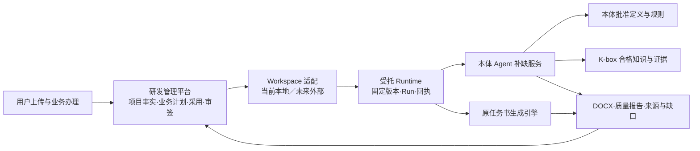

# 研发管理平台方案对齐与分阶段开发计划

> 状态：**待评审，尚未批准实施**。编写日期：2026-11-01。
> 本次只新增计划资料，不修改应用代码、数据库、服务配置或运行状态。
> 后续每批修改必须先写清需求依据、影响范围、开发任务、迁移和验收，再按确认范围实施；不能以“继续优化”代替开发计划。
>
> **For agentic workers:** 实施已确认批次时使用 superpowers:subagent-driven-development 或 superpowers:executing-plans，逐任务核验；本文中的后续阶段不能视为一次性实施授权。

**Goal:** 在保留原研制任务书生成能力的前提下，将现有研发工作树逐步对齐补充方案，先交付任务书首场景，再扩展全流程和外部平台协作。

**Architecture:** 研发管理平台持有项目业务事实和唯一业务编排；当前同部署的本地 Workspace 提供资源与执行适配，未来逐项替换为外部服务。本体提供批准语义、规则及补缺服务，K-box 提供经治理的证据；原任务书引擎继续承担文档生成。

**Tech Stack:** 延用现有 React / TypeScript / Vite、Python / FastAPI、SQLite、DOCX 处理管线。当前不选购或引入新的流程引擎、图数据库、消息中间件。

**Spec:** 本次提供的《整体方案.md》与六份《主题方案》，详见[资料与差异索引](2026-11-01-rd-platform-evidence.md)。当前实现依据为 `codex/rd-platform-rebuild-20261031` 工作树；任务书能力对照 `codex/taskbook-expand-16-types`，不能把旧附件中误选的连接器模板作为管路模板的版式基线。

## 1. 范围与实施顺序

这不是把侧边栏名称和列表样式换一遍。需要同时纠正业务阶段、模板与能力含义、版本采用、执行与工程决定的边界。

推荐沿补充方案的 B 路线演进：**持久业务流程控制＋Agent/Skill＋流程与领域本体契约**。近期保留已经可用的本地执行器，明确其能力范围；不宣称已具备企业级流程引擎、任意本体自动编译或全部专业能力。

| 批次 | 可交付结果 | 本批不包含 |
|---|---|---|
| P0 基线保护 | 可复核的代码、任务书资产、样本、数据清单与能力差异 | 新功能和数据迁移写入 |
| P1 首场景业务纠偏 | 需求确认→选型→研发启动→策划中编制任务书→正式工程任务的正确衔接 | 完整图形设计器、外部平台和专业工具接入 |
| P2 本地能力治理与流程设计器 | 选型/研发两类模板、专家团动作模板、同一草稿的图形编排、授权采用 | 任意代码即拖即执行、自动专业签署 |
| P3 有依据的自动补缺与模板派生 | 现有补缺台账上的有限迭代；可审核的目标模板差异和资产包 | 无依据填满、将低频指标自动当作高频事实 |
| P4 外部适配与分域迁移 | Workspace、本体 Agent、K-box 逐项接入与迁移演练 | 一次性搬走全部数据或切换所有在途任务 |
| P5 全流程扩展与企业验收 | 多专业任务、设计/试验/仿真、受控交付、知识治理及专项验收 | 用本地首场景测试代替合同全量验收 |

P0 与 P1 的具体开发任务见[首批开发任务](2026-11-01-rd-platform-phase1.md)。P2—P5 在本文固定边界、依赖和接受条件；进入各批前再形成对应详细开发计划。主题方案中的 32 个 BUILD、81 条正式需求不被本文的批次重新编号或替代，待原追溯台账到位后建立关联。

## 2. 全局约束

1. **原生成能力保留。** 研发工作包通过 `engine_bridge.py → src.pipeline_cli.run_pipeline` 调用现有生成链。不得另写只拼文字的生成器替代模板、Profile、mapping、受控规则、原文搬运及质量检查。
2. **当前输入仍手动上传。** 示例接口必须标记未连接；示例库存、示例审签、示例匹配率不进入真实项目。
3. **工作包内部自动执行。** 提交以后不逐步骤弹窗追问。能从获准来源补齐则自动执行；无法证明的工程值保留缺口并停止相关动作。
4. **业务决定独立。** 用户确认需求、选型决定、研发启动、任务书范围批准、后续审签分别记录。工作包运行成功不能替代这些决定。
5. **参数来自业务证据。** 六参数由来源识别、适用规则、项目资料及已确认业务决定形成；界面展示中文、来源和冲突，只对必要缺口澄清，不重新要求填写一整套技术参数表。
6. **保留历史与版本。** 新模板、新模型、目录新版不自动覆盖已采用输入；查看旧成果不触发重算。
7. **只有一个业务调度 Owner。** Runtime 推进受托能力步骤，不能另建项目主账或自行批准业务阶段。
8. **同部署也分职责。** 本地 Workspace 是过渡能力域；研发管理员身份不自动等于资源发布、应用授权、专业审核权限。
9. **环境兼容继续有效。** 保留容器端口 80 同源入口、OA/本地模式、管理员、日志、反馈、资料、审阅和下载；Chrome 104 滚动与页面可用性、Word 2007 打开能力分别验证。
10. **状态如实表达。** 代码测试、浏览器演练、真实模型生成、Word 客户端、工程审签、外部系统接收分别留证，不能合并为一个“通过”。

## 3. 新资料对既有理解的修订

| 事项 | 本计划采用的口径 | 理由与适用边界 |
|---|---|---|
| 需求确认与审签 | 澄清采纳后确认需求，直接进入选型；默认不增加独立需求审签 | 整体方案第 2 节明确更新；企业制度另有必审时按有效配置办理 |
| 选型单与研发项目 | 可共享一个 Project 技术容器，业务身份和启动状态必须分开 | 上传受理不是正式立项；研发编号仅在具备有效启动依据后分配 |
| 任务书所在阶段 | 属于改型/新研策划；范围批准后再下发正式设计任务 | 当前将任务书包限制在 design，不能只改页面标题 |
| 工作包与动作模板 | 工作包组织本次交付；动作模板对应固定专家团；内部执行函数是 Skill/步骤实现 | 不把现有六个函数直接等同于六个专家团，也不把每个内部步骤当正式 WBS 任务 |
| 自动执行与人审 | 自动工作包内部不逐步问人；正式工程决定在业务工作面办理 | 与用户“提交后自动执行”约束并存；没有真实资格及决定时不生成假签名 |
| 所有模板缺项 | 覆盖必需字段、章节、表格、证据和约束，区分允许留空、说明文字、历史内容 | 补齐有来源的事实，不能把所有空单元格机械填满 |
| 本体 Agent 查 K-box | 补缺服务可自行受权查询 K-box，研发接收结构化结果与证据 | 本体 Agent 不因此拥有项目批准权；其执行实现由 Workspace 资源治理 |
| 暂时合体 | 当前允许本地实现并同部署，逻辑域、权限和数据归属仍区分 | 不因尚未提供外部 API 而停止可用的本地功能 |
| 没有目标模板 | 先判断可否由获准动作和资产组合；缺专业定义则形成治理事项 | “没有模板”不等于产品必须新研；不能默选最相似产品模板 |
| 目录和画布 | 资源目录按授权范围、默认每页 5 条；画布需有草稿、校验、差异与采用 | 当前卡片 12 条/页和仅视口平移不是最终规范 |

前述属于本次计划对资料的解释，仍处于评审稿。若用户后续对具体制度给出新口径，先更新计划和影响范围，再实施。

## 4. 当前实现与目标的差异

| 能力 | 已有基础 | 尚缺内容 | 对应批次 |
|---|---|---|---|
| 项目与来源 | Project/Case、文件版本、摘要、来源采用、项目权限 | 选型业务身份、启动授权与研发身份清楚分开 | P1 |
| 需求办理 | 解析候选、澄清、采纳、输入修订 | 独立需求确认命令；固定需求基线与更新影响 | P1 |
| 任务书策划 | 两条研发路径、六参数、固定 DOCX/Profile/mapping | 策划阶段执行任务书；范围批准与设计下发解耦 | P1 |
| 成熟产品选型 | 逐项比较和路线记录 | 固定选型报告、送审包和真实决定；真实供给核对接口 | P1／P5 |
| 工作包运行 | DAG 校验、快照、CAS、幂等、租约、取消、迟到结果拒收 | 业务节点/动作实例/Run 映射，有限分支和受控修订 | P2 |
| 流程管理页面 | 四类目录、搜索、分页、画布、节点详情 | 总览和治理入口；选型/研发类别；图形编辑与同一草稿 | P2 |
| 画布 | 实际依赖连线、缩放、视口平移、列表、有限增删动作 | 节点拖入/移动、连线编辑、撤销重做、差异预览、授权采用 | P2 |
| 资源工作台 | 本地资源版本与发布状态、执行器绑定检查 | 资源域权限、应用投放、专家团固定成员及依赖闭包 | P2 |
| 自动补缺 | 已扫描必需章节、占位及表格空项，区分合理空白 | 有限证据查询—校验—再核缺循环与结构化停止原因 | P3 |
| 模板派生 | 无完整资产时阻断并形成候选包 | 目标产品的差异规则、适用性审查、资产验证及发布 | P3 |
| 外部能力 | 示例 contracts、local_real 实现 | 真实厂商接口适配、撤权/回调/状态查询/对账 | P4 |
| 后续工程 | 专业成果记录、输入变更失效、交付及复用候选 | 真正的多专业任务、工具回执、资格审签及治理发布 | P5 |

这些是实现状态的核对，不是本轮新增功能。现有画布及局部浏览器验证可复用，不需要推倒重做；完整生产能力仍须按表中缺口实现。

## 5. 领域模型与数据归属

### 5.1 稳定对象

| 对象 | 表达什么 | 不应与什么混用 |
|---|---|---|
| Project / ResearchCase | 项目容器及一次业务办理上下文 | Workspace 协作空间 |
| SelectionOrder | 从需求分析到选型决定的一次办理 | 已批准研发立项 |
| RequirementBaseline | 已确认条目、来源、采用值与范围的固定版 | AI 解析候选、原文件所有段落 |
| ParameterFact | 六参数的值、依据、冲突和采用记录 | 无来源的默认值 |
| WorkflowTemplate | 选型或研发业务流程、关口与责任，固定版本 | 任务书 DOCX 模板 |
| WorkpackageDefinition / Workpackage | 可复用交付单元定义／本次执行计划及交付目标 | 专家团资源定义 |
| ActionTemplate | 一个固定专家团的输入输出和能力入口 | 本体 Action 语义定义、单个 Python 函数 |
| ActionInstance / Run | 本次节点中的动作实例／某次受托运行 | 模板定义、同名历史动作 |
| ReportTemplate / ControlledTemplateAssetSet | 文档结构／DOCX＋Profile＋mapping＋适用规则固定资产 | 业务流程或能力 DAG |
| Decision / ReviewBundle | 具名主体对固定对象版作出的业务决定／被审包 | 模型“通过”、运行 completed |
| CompletionObligation / EvidenceRef | 缺口与可核验的来源 | 猜测值、只有相似度的推断 |

现有 `resolve_context/template_plan/content_completion/generate/verify/consistency` 保留执行标识，通过显式映射进入 Skill 或专家团内部步骤；不能原地改 ID 导致旧快照不可执行。

### 5.2 四平台及执行关系

图表示职责与调用契约，不表示外部平台已连接。K-box 自身的知识治理 Job 仍由 K-box 持有；它可调用获准 Workspace 资源，不能让研发运行器接管其治理主账。

### 5.3 本地过渡

- 原件、转换件、草稿、失败尝试和最终成果留在研发项目资产域。
- 共享资源定义与发布记录进入本地 Workspace 域；业务只读目录是投影，不再拥有一份可编辑副本。
- 本体规则与知识查证暂由本地适配器服务上传资料和受控规则，显式声明 local，不伪装远端治理。
- 将来外部 API 到位后按 provider 切换，项目引用稳定逻辑 ID、固定版本和摘要。
- 专家团内部实现升级不静默改变旧项目执行包；授权效期、撤权、数据访问限制仍在执行时复核。

## 6. 首场景业务流程

### 6.1 上传与受理

1. 上传需求及规范，先保存原件、hash、角色和访问范围，再异步解析。
2. 创建/定位唯一选型事项与关联项目；重复提交同一意图返回同一回执。
3. 来源识别产品、系列、领域、工况、已有指标；无法判断的保留未知。
4. 采用适用选型流程固定版，展示来源和缺项。此时不分配虚假的研发立项编号。

### 6.2 需求增强、澄清与确认

- 原文、规范条款、AI 建议、澄清答复、采用值分开。
- 拒绝候选保持拒绝；批量采纳不能把它恢复。
- 缺客户指标转澄清，不用模型凭空补耐受阈值。
- 用户确认当前需求版后进入选型。默认没有额外的独立需求审签门。
- 新资料或工况改变只使受影响结论待复核；不清空历史。

### 6.3 成熟产品比对及路线

- 按当前有来源的需求条目逐项比较，保留未知、冲突和不适用；匹配率展示分子、分母及口径。
- 原型的 90%、100%、50% 只作为演示情节，不能写成常量或跳转阈值。
- 先形成固定选型报告，核对后送适用审签；批准绑定报告/输入/产品证据版本。
- 直接选用进入供给核对及交付接收，不创建研发 WBS，不强制任务书。
- 改型/新研须有独立启动依据，承接原需求和差异，不把“选型通过”当“研发完成”。

### 6.4 研发策划及任务书

1. 展示研发流程推荐卡：适用性、必需输入、固定版、必要节点、允许裁剪、角色和推荐依据。
2. 分别固定研发流程模板与任务书文档资产，展示自动形成的六参数及来源。
3. 在策划节点拉取任务书工作包，查看交付目标和节点。无需调整时可直接确认；需要时添加获准节点并校验。
4. 提交固定输入和计划快照后自动执行原有编制链，保存文档、来源、质量报告和缺口。
5. 技术生成完成、正式交付门禁通过、任务书范围批准分别展示。
6. 任务书范围具备有效批准后下发工程任务，进入方案/详细设计。没有相应依据时保持该业务关口待办，而不是让模型签署。

### 6.5 后续阶段

方案、详细设计、整合、试验/仿真、设计定稿、交付接收和知识发布各自维护事实、证据与决定。首批只保证任务书成果能正确交接，不用一段手工“已完成”说明替代专业工具执行和正式签发。

## 7. 流程管理与画布目标

### 7.1 页面结构

保持现有 JONHON 风格、左侧主导航、设置入口和滚动行为。流程管理增加清楚的功能入口：

- 总览：已开放流程、待处理治理事项、项目采用及运行异常。
- 流程模板：**选型流程／研发流程**；工作包定义作为可复用单元关联展示。
- 动作模板：专家团组成、固定版、输入输出、适用范围、许可和执行就绪状态。
- 智能体与 Skill：应用获准的只读资源目录。
- 报告模板：真实受控文档资产及发布版本，保持独立治理链。
- 画布与治理：从具体模板/项目进入，始终显示编辑对象、版本和保存状态。

目录依资料默认每页 5 条，服务端按授权过滤后统计与分页；返回页面恢复筛选、页码和节点定位。权限不足、暂无资源、加载失败、未绑定执行器分别显示，不用同一个空白页处理。

### 7.2 两层画布

**业务画布归研发：** 节点、依赖、责任、计划、必要业务决定和交付物；允许插入已授权动作模板实例。

**专家团内部能力画布归 Workspace：** Agent/Skill、工具、有限迭代与结果契约；研发可以查看固定组成，不能借业务画布修改共享资源定义。

画布编辑要求：

- 草稿增删节点、拖动位置、建立/删除依赖、节点属性和撤销重做。
- AI、对话和手动编辑提交同一种结构化差异草案；AI 不静默覆盖用户已确认约束。
- 节点实例有独立 ID；复制同名节点不能继承完成状态。
- 校验输入输出、依赖、循环、必需关口、固定资源、权限和角色，错误定位到节点/连线。
- 保存、校验、差异预览、采用、提交执行分开；只移动坐标不改变工程状态或触发运行。
- 已运行实例只读；在途变化形成新修订及影响分析，在安全边界采用。
- 试运行隔离，不派真实任务、不签署、不调用外部写操作。
- 当前 Worker 支持范围之外的分支、循环、并行不得仅靠画布连线宣称可执行。

## 8. 数据与接口演进

### 8.1 版本不能共用一个数字

至少分别保存：

- 定义/资源固定修订及内容摘要；
- 发布、授权等当前状态版本；
- 项目 input_revision；
- 工作包 plan_revision 和执行 bundle 摘要；
- 决定绑定的对象/报告/输入版；
- 单次 run_id、attempt、租约 fencing 标识。

新发布版不改历史；状态变化也不能伪造新的内容修订。

### 8.2 沿用已有业务接口

当前 `/api/rd/projects/{pid}/commands` 已有版本检查和幂等回执。首批在同一命令通道扩展有明确语义的操作，不另建第二套项目服务。后续计划接口名称均为**本项目拟定逻辑契约**，不是厂商现成 API：

新政策由服务端固定。对 v2 案例，旧通用 advance_stage 也必须经过相同准入检查或被拒绝，不能仅修改界面而保留可绕过业务决定的旧 API；客户端不能自选旧政策降级。

| 逻辑操作 | 输入 | 返回与限制 |
|---|---|---|
| confirm_requirements | case_id、expected_input_revision、范围、来源 | 固定需求基线及确认回执，不生成工程审签 |
| record_selection_decision | 固定 report/baseline/product 引用、verdict、依据 | 有效选型决定；错版拒绝，工程资格按配置验证 |
| authorize_rd_start | 已生效选型决定、范围、授权依据 | 启动事实、流程权限与后续采用条件 |
| prepare_execution_bundle | 固定目录版、节点差异、输入及交付目标 | 不可变候选；不派工、不推进工程状态 |
| adopt_execution_bundle | candidate_id、摘要、expected_version、所需决定 | 采用回执；重新检查当前许可 |
| submit_workpackage | 固定采用包、预算、模型及意图 ID | 唯一 Run 关联，复用已有幂等和租约机制 |
| record_taskbook_scope_decision | 固定任务书、输入、质量结果、范围及决定 | 具备条件才允许工程任务下发 |

候选准备、采用、运行提交不能共用“保存成功”回执。拟定字段在每批契约评审后封版；外部 OpenAPI 未实得前不得据此拼造远端 URL。

### 8.3 外部适配器

- Workspace：授权目录、固定制品、依赖锁、当前许可、运行委托/查询/取消。
- 本体：批准定义、适用性、规则评价、补缺请求与结构化候选；补缺服务内部可受权查询 K-box。
- K-box：有权限的合格知识、证据定位、固定版、有效性/撤回信息；不接受研发直接把未治理草稿当正式知识写入。
- Runtime：Run 状态、真实产物、技术等待、取消及恢复；不写工程批准。
- 企业系统：供给、PDM、试验/仿真独立适配；结果未知先查原请求，不盲目重发。

跨域阶段再引入 Outbox/Inbox、事件去重和对账；本地已经存在的事务 CAS、意图幂等、租约和旧结果拒收继续复用。

## 9. 自动补缺与新模板派生

现有 `completion.py` 已有缺口台账。后续扩展为：

**扫描义务 → 受权查证 → 提出候选 → 规则及来源校验 → 重算缺口 → 收敛或明确停止。**

每轮保存目标字段/章节、查询依据、来源定位、规则版、候选、拒绝理由及消除的缺口。循环受最大轮数、预算、截止时间、取消和“无新增证据”控制；数值阈值在专项计划中配置，不虚构企业标准。

允许自动接受有确定性映射/批准规则且满足权限及适用性的内容。涉及新的客户承诺、未给出的性能数值、真实试验结果或需专业判断的冲突，保留待决，不由 Agent 填成正式事实。

低频→高频派生必须产生完整目标资产：模板、Profile、mapping、规则、适用范围、来源和回归样本。结构可复用，专业指标及方法必须有目标产品证据。派生成功先是候选，经过适用性核验和规定发布后才进入可用目录。普通项目使用既有发布版不应再次触发公共模板审批。

## 10. 原任务书能力保护

### 10.1 固定对照样本

主样本使用用户已确认的两份液冷输入，参数固定：

| 参数 | 基准 |
|---|---|
| 产品类型 | 液冷产品—液冷管路 |
| 质量管理体系 | 军品 |
| 研制流程 | 改型 II |
| 封面阶段 | S |
| 产品系列 | YLZJ |
| 产品归属 | 非中央研究院产品 |

使用液冷管路受控模板。旧附件实际匹配液冷连接器模板的内容不能作为替换管路模板的理由。样本 manifest 记录原件 hash、版本、模板/Profile/mapping/规则摘要、模型、引擎版本、实际结果和接受差异。

### 10.2 回归检查

- 六参数、两输入和固定资产完整传递给原引擎；不绕过模板注册和适用性判断。
- 方案中任务书“15 类内容”是逻辑内容模型，按客户有效模板映射；不把所有受控 DOCX 强行改排为统一 15 章。
- 正文覆盖可追溯到来源；表格、图片、公式、编号、字体及环境章节按原规则核查。
- 环境适应性遵循用户补充的专项环境要求识别和文字表述，不把全部技术指标倾倒进该章节。
- 保留仿宋五号表格规则、封面多行名称与日期版式等已确认修复。
- 原模板本身漏两条边框不列为必须修复项，按用户已明确取舍。
- Word 2007 结构检查与真实客户端打开分别记录；WPS 可打开、Python 可读 XML 均不能替代 Word 2007 验收。
- DOC 转换复核、缺依据、孤立图题等真实问题继续阻断相应交付，不因需要演示跑通而放宽门禁。
- 模型非确定性使逐字或二进制相等不适合作唯一标准；参数/资产/来源完整性和工程结果分别对比。

如回归暴露引擎问题，另建有样本和预期的修复任务，先补计划，不夹带在页面重构中修改。

## 11. 分批开发、依赖与退出条件

### P0：基线与差异登记

- 固定当前工作树未提交改动的清单，不回滚、不擅自合并。
- 记录原引擎与研发桥接的接口、样本和已知质量限制。
- 建立方案要求→当前模块→开发批次→证据索引。
- 读取实际数据库模型和文件引用，形成只读迁移清单。

**退出条件：** 同输入的引擎调用路径、资产来源和能力差异可以复核；已知未通过项独立列明。

### P1：首场景业务阶段与任务书位置

- 新增明确的需求确认、选型决定和研发启动语义。
- 选型事项与正式研发身份区分，复用同 Project 关联。
- 任务书在新版本策划流程内执行，范围批准后进入设计。
- 六参数继续从资料与业务决定获得，提供必要澄清和来源视图。
- 老项目按原流程政策读取；新流程不原地改活动 Run。
- 用户可沿 1—4 业务入口办理，原生成能力不改变。

**退出条件：** 正常、缺资料、拒绝/改型/直接选用、重复提交及输入变更均有正确去向；任务书输出保持原引擎约束。正式制度未接入时，不把本地业务确认标为企业电子审签。

### P2：资源治理与完整设计器

先完成资源/定义/实例的固定引用和目录许可，再完成图形编辑与运行映射。可拆成 P2A 本地 Workspace 分域和 P2B 流程设计器，两者各自验收。

- P2A：资源发布、应用授权、项目采用分开；研发只读目录，维护进入本地 Workspace 域；发布与授权权限分离；当前应用过滤所有目录出口。
- P2B：两类业务模板、专家团动作、图形和表单同一草稿、校验、差异、采用、回退历史；新增未绑定能力显示不可执行。
- 先支持可证明的依赖和有限分支；超出运行器能力的结构阻断发布，不假造支持。
- 业务画布和专家团内部画布职责隔离；已执行工作包不可通过拖拽覆写。

**退出条件：** 编辑后实际采用的图与执行图一致；无权限资源不从搜索/详情/分页/导出泄漏；在途固定版不被目录新版替换。

### P3：补缺与派生

分别规划“证据补齐循环”和“模板派生治理”，不把两个完成标准混在一起。复用原受控生成链和缺口台账。

**退出条件：** 有依据缺项能补、无依据能准确停止；高频候选不会以低频名称改写方式直接发布；取消和预算停止保存完整证据。

### P4：外部接入与迁移

以真实 API、身份、错误码、版本、状态、取消、撤权和回执契约为准。每个 provider 先契约测试，再只读影子，再新任务试点，最后迁移适用的安全检查点。

**退出条件：** 一个权威写入方、完整 ID 映射、旧成果可读；超时未知/重复/乱序/撤权/重启均可对账，示例返回不会被当生产证据。

### P5：全量业务与企业专项

根据原 BUILD/WBS 接续多技术组任务、审核资格、CAD/CAE、BOM、实验、PDM/ERP、治理结项和画像。性能、容量、权限和恢复在对应环境验收。

**退出条件：** 原需求台账逐项有真实证据；原型页面或目录数量不代替实际业务与供货验收。

## 12. 数据迁移和回退

1. **盘点：** 项目/案例、来源、需求/澄清/决定、模板采用、工作包/Run、资源版本、成果与文件 hash；凭证不进入迁移报告。
2. **建立映射：** 旧项目 ID、案例 ID、动作 ID、模板 ID、资源 ID 和旧状态保持可追溯。旧数据没有启动依据就标明“历史待核”，不得补造批准记录。
3. **兼容读：** 为新记录启用流程政策 v2；旧采用快照继续按 v1 解释。不能在读取时静默把所有 design 包改成 planning。
4. **迁移预检：** 离线副本上检验关联、文件摘要、业务决定与状态，输出差异；报告必须可预览，确认前不写活动库。
5. **写入控制：** 先迁完成/未提交对象；活动 Run 留原 Owner，或在确定安全点受控续办。
6. **迁移接受：** 总量、引用、权限、文件摘要和未决事项一致，原件和历史仍可查。
7. **回退：** 新批次尚未形成业务写入时可切回旧读取；已产生新写入后，必须采用有记录的逆向迁移/对账，不用旧库覆盖新事实。
8. **分域迁移：** 原始业务资料留研发，发布资源迁 Workspace，批准定义迁本体，合格知识迁 K-box；不是把整个 data 目录复制给四个平台。

## 13. 验收与 Review Focus

以下五类跨阶段风险必须在对应任务中落实测试：

| 高风险输入/条件 | 预期行为 | 所属任务/批次 |
|---|---|---|
| 缺指标、冲突来源、资料变化 | 不补造数值；固定确认失效有范围；保留历史 | 首批 T2/T5/T8，P3 |
| 同名节点、强制节点删除、非法环 | 新实例独立；服务端拒绝破坏必要顺序；图与执行一致 | P2B |
| 重试、过期版本、迟到结果、取消 | 回原回执或拒绝错版；不重复执行、不自动恢复取消 | 首批 T1/T3/T7/T8，P4 |
| 旧项目/旧模板和新规则混用 | 版本显式采用；旧 Run 不换包；没有历史依据不造批准 | 首批 T0/T4/T7 |
| 技术成功但无工程批准、无外部回执 | 分开显示状态；不能推进设计/交付或伪造接收 | 首批 T3/T4/T6，P5 |

接受证据包括：代码行为测试、接口回执、迁移差异、浏览器截图、真实样本生成与客户端打开记录。每一类标注未执行/通过/未通过及环境。

正常闭环至少覆盖：直接选用不生成任务书；改型生成管路任务书；新研缺目标资产进入治理；需求修订后相关成果待复核；拒绝项不被重新批量采用。异常闭环包括：无权限、无执行器、超时未知、重复提交、重启恢复、图循环和旧回调。

## 14. 当前资料缺口与进入后续批次的条件

本次目录内未找到《整体方案》引用的“全局梳理与运行补充方案”、外部《应用接口OpenAPI.json》、全平台数据字典、84 节点装配 JSON、正式 81 条需求证据台账及原 BUILD 台账。主题文件中的内嵌规则可用于设计，不能据此声称已核对这些独立机器契约。

以下不阻止本次计划形成，但在相应批次前必须落实：

- 正式工程审签的角色、资格、签署方式和制度范围：决定哪些关口允许本地具名确认，哪些必须对接企业系统。
- Workspace/本体/K-box 的真实接口和应用身份：决定外部适配；OA 登录应用 ID 不直接当成能力授权服务身份。
- 流程引擎具体产品、许可、部署与容量：进入复杂并行、长等待和全量工程流程前确认；当前不贸然增加第二个调度器。
- 原始需求追溯与 BUILD 台账：全量范围沿原账关联，不因首场景分期漏项。
- Word 2007 验收环境与实际复测文件：只能依据客户端结果关闭该兼容风险。

**建议评审先确认 P0＋P1 范围；之后逐批审阅开发计划。当前不实施、不提交现有代码。**
